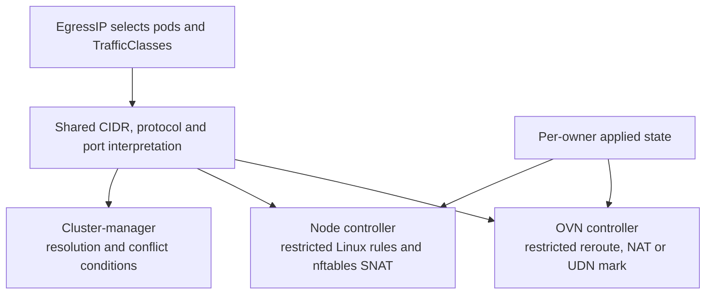

# Egress Traffic Class review guide

**Goal:** let one pod use different EgressIPs for different destinations or ports, with an optional catch-all for other traffic. For example: UDP/5060 uses one address, TCP/443 uses another.

Allocation, node assignment, health checks and topology-specific forwarding stay in the existing EgressIP controllers. The substantial changes are **packet matching, per-owner state and shared-resource cleanup**.

Start with commit 1 and work down to commit 7. Within each commit, read the changed code in the table order. Each row says what to open and what you should understand before moving on.

The [behavior reference](#behavior-reference) below explains the before/after behavior and design choices by topic.

## Rebase notes

Rebased onto `upstream/master` at `98bd8874f`. Commit numbers below follow `git log --reverse --oneline upstream/master..HEAD`; hashes are omitted because rebasing changes them.

**The substantial integration change is in commit 3:** upstream now brings EgressIP networks up independently. Read `SyncNetworkReady` → `ensureNetworkRegistered` → `syncNetworkStaleEntries` in `ovn/egressip.go` before reviewing startup repair.

| Upstream change | How this stack fits it | Reviewer focus |
|---|---|---|
| Each network finishes stale cleanup before live programming is allowed | Selective migration and repair use the same network filter; OVN NAT migration runs only for the default network | One network's startup must not rewrite another network's policies |
| A controller lifecycle lock serializes startup/teardown against live handlers | TrafficClass events take the read lock before the per-owner cache lock | Class edits follow the same lock order as EgressIP, pod and namespace events |
| Networks finish cleanup at different times | Destination-set pruning checks remaining policy/NAT references before deletion | A set shared with a network awaiting cleanup must survive until its references are gone |
| Shared-gateway pod egress now uses a default route upstream | Selective EgressIP reroute policies still override ordinary routing | Unmatched traffic uses a catch-all EgressIP when present, otherwise the updated normal egress path; see [gateway modes](docs/design/gateway-modes.md) |

The OVN lifecycle fixtures now use per-network readiness, and `TestPruneEgressTrafficPreservesReferencedSets` covers retaining and later deleting a stale destination set. These changes were inspected and formatted, **not executed or compiled** during this rebase.

## Review order within each commit

**Path key:** paths below start at `go-controller/pkg/` unless they explicitly start with `go-controller/`, `docs/`, `test/`, `helm/`, `contrib/`, or `.github/`. Root Markdown files are at the repository root. Read test files as examples alongside the implementation; no test execution is needed for this walkthrough.

### Commit 1 — Manual API

Understand the public API before reviewing its generated representation.

| Order | Read | What to look for |
|---|---|---|
| 1 | `crd/egresstrafficclass/v1/types.go` | Establish the packet-selection contract—CIDRs, protocols, ports and validation markers. |
| 2 | `crd/egressip/v1/types.go` | See how an EgressIP selects those classes and exposes conditions alongside assignment items. |
| 3 | `test/crd-integration/egresstrafficclass_test.go`, then `suite_test.go` | Read the accepted/rejected API examples and how admission coverage is wired. |
| 4 | TrafficClass `doc.go`, `register.go`, and `openapi/cmd/models-schema/main.go`; then `go-controller/hack/update-codegen.sh`, `docs/Makefile`, and `docs/api-reference/introduction.md` | Check registration and generation inputs after understanding the schema. |

### Commit 2 — Generated API

Verify that generated artifacts preserve the API contract from commit 1.

| Order | Read | What to look for |
|---|---|---|
| 1 | `helm/ovn-kubernetes/crds/k8s.ovn.org_egresstrafficclasses.yaml`, then `k8s.ovn.org_egressips.yaml` in the same directory | Compare the installed schema, validation and status configuration with commit 1. |
| 2 | Both API reference pages under `docs/api-reference/` | Check that the published contract reflects the types. |
| 3 | Both CRDs' `v1/openapi/zz_generated.openapi.go`, deepcopy code and apply configurations | Check field coverage and list/merge semantics, including `Items` before `Conditions` in the generated status struct. |
| 4 | TrafficClass generated clients, informers, listers and registration | Skim the plumbing last. Its correctness depends on the API contract above; there is no new reconciliation policy here. |

### Commit 3 — Shared semantics, OVN and conditions

Follow shared matching → owner state → OVN programming → status reporting → event wiring.

| Order | Read | What to look for |
|---|---|---|
| 1 | `util/egressip/destination.go` and its tests | Understand normalization, wildcard behavior and overlap detection before either controller consumes them. |
| 2 | `config/config.go` and `types/const.go` | Establish gate behavior and selective/catch-all priorities, including changes that apply with the gate off. |
| 3 | `ovn/egressip.go` | Start with `podAssignmentState` and assignment add/delete paths. Establish per-owner state and shared-resource lifetime before reading packet builders. |
| 4 | `ovn/egress_traffic_class.go`, then the reroute, SNAT and marking builders in `ovn/egressip.go` | Trace resolution → match construction → assignment rebuild. For startup, follow `syncEgressIPs` (default network) or `SyncNetworkReady` (queued network) → `syncNetworkStaleEntries`, then migration and pruning. Check the network filter and shared destination-set references. |
| 5 | `clustermanager/egress_traffic_conditions.go`, then status-writing changes in `clustermanager/egressip_controller.go` | Compare conflict semantics with the shared parser and check that condition/assignment writers preserve each other's fields. |
| 6 | `factory/` changes, `util/kube.go`, then OVN controller/event-handler wiring | Verify which events reach the reconciliation paths just reviewed and how the gate controls watches. |
| 7 | Corresponding tests; existing `ovn/egressip_test.go`; fake-client and mock changes | Check the scenarios alongside each path above, then catch-all compatibility. Skim fake-client and mock updates last. |

**Reading the reconciliation helpers:** start with the entry point, then follow only the step you want to inspect. The traversal functions keep network selection and transaction ordering visible; the helpers own the individual decisions.

| Entry point | Follow next | What the split makes clear |
|---|---|---|
| `addPodEgressIPAssignments` | `deferToActiveCatchAll` | Catch-all active/standby arbitration is separate from programming an owner's statuses |
| `deleteEgressIPAssignments` | `deletePodEgressIPStatus` → `finishPodAssignmentRemoval` | Traverse under the pod lock, remove one status under the node lock, then release shared resources |
| `syncStaleGWMarkRules` | `deleteStaleGWMarkPolicies` / `isStaleGWMarkPolicy`, then `ensureGWMarkPolicies` | Finish stale-mark deletion before building the expected marks; creation still uses one transaction across owners |
| `ensureGWMarkPolicies` | `ensureOwnerGWMarkPoliciesOps` → `ensurePodGWMarkPolicyOps` | Select the owner/network, select local assignments, then render matching pod IPs |
| `syncPodAssignmentCache` | `restoreNetworkEgressIPAssignments` → `restorePodEgressIPAssignment` | Read persisted policies/NATs once per owner/network, then restore each pod's active or standby state under its lock |
| `syncStaleEgressReroutePolicy` | `staleEgressReroutePolicy` | Decide whether the whole policy or only some next hops are stale before applying deletions |
| `reconcileTrafficConditions` | `setOverlappingTrafficConflicts` | Compare owner pairs separately from destination pairs; keep the first overlap for stable condition messages |
| `ParseDestinations` | `parseProtocolMatch` → `parsePort` | Expand and deduplicate the destination list separately from validating each protocol and port entry |
| `migrateEgressIPReroutePriorities` | `migrateRouterEgressIPPolicies`, then `migrateEgressIPNATMatches` | Preserve the network filter, one transaction per router, and default-network-only NAT updates |

### Commit 4 — Secondary-host datapath

Follow Linux rule representation → routes and SNAT → reconciliation and cleanup.

| Order | Read | What to look for |
|---|---|---|
| 1 | `node/iprulemanager/ip_rule_manager.go` and its traffic tests | Establish how destination/L4 fields survive rule identity, netlink conversion and deletion. |
| 2 | `node/controllers/egressip/traffic.go`, then `nftables.go` | Understand destination routes, shared ownership and selective SNAT before following their callers. |
| 3 | `node/controllers/egressip/egressip.go` | Follow `processEIP` → `generatePodConfig` → `updateEIP`; inspect locking, partial-failure bookkeeping and peer-reference checks, then `repairNode` for restart cleanup. |
| 4 | `node/controllers/egressip/pod.go` and `node/default_node_network_controller.go` | Check workload/class event handling and controller startup wiring. |
| 5 | `node/controllers/egressip/traffic_test.go`, then `egressip_test.go` | Read lifecycle, shared-route failure and existing catch-all scenarios against the implementation above. |

**Reading the host reconciliation helpers:**

| Entry point | Follow next | What to look for |
|---|---|---|
| `updateEIP` | `deleteStalePodConfigs` → `deleteStaleEIPConfig` → `applyEIPConfig` | Cleanup precedes application; shared references and each successful mutation remain recorded for retry |
| `repairNode` | `expectedPodConfigs` → `generatePodConfig` | Workload/network selection is separate from comparing expected rules, routes, addresses and SNAT with node state |
| `replaceDefaultRouteWithDestinations` | `longestCoveringRoutes` | Keep non-default routes, find the longest covering prefix, and preserve all tied route alternatives |
| `Run` | `runSelectiveSNATReconciler` | Periodic SNAT repair keeps its shutdown handling and configuration lock in one worker |

### Commit 5 — Deployment

Trace the operator setting through component arguments, permissions and local-cluster setup.

| Order | Read | What to look for |
|---|---|---|
| 1 | `helm/ovn-kubernetes/README.md` and the two changed `values-*.yaml` files | Establish the operator-facing switch and defaults. |
| 2 | Changed control-plane and node chart templates | Trace that switch into component arguments across deployment variants. |
| 3 | Cluster-manager and node RBAC templates | Check that the components watching classes and writing status have the required permissions. |
| 4 | `contrib/kind-common.sh`, then `contrib/kind-helm.sh` | Follow local-cluster configuration into Helm values. |

### Commit 6 — E2E coverage

Check which externally visible behaviors the scenarios assert and how CI enables them.

| Order | Read | What to look for |
|---|---|---|
| 1 | `test/e2e/egressip.go` | Read scenario setup and assertions first—what observable routing/SNAT and lifecycle behavior is promised? |
| 2 | `test/e2e/util.go` | Inspect the traffic/probing helpers behind those assertions. |
| 3 | `.github/workflows/test.yml` | Check that the intended CI jobs enable the feature and exercise the scenarios. This is a reading order, not a request to run them. |

### Commit 7 — Documentation

Check that user instructions and review notes agree with the implementation.

| Order | Read | What to look for |
|---|---|---|
| 1 | `docs/features/cluster-egress-controls/egress-traffic-class.md` | Compare examples, supported combinations, conflict behavior and upgrade/rollback instructions with the implementation. |
| 2 | `mkdocs.yml` | Check that the feature page is discoverable. |
| 3 | `egress-traffic-class-review-guide.md`, then `egress-traffic-class-pr-plan.md` | Use this guide to cross-check the change map; consult the plan for design rationale and historical validation, not as proof that the current stack was tested. |

## Behavior reference

Use these topics when you need the rationale behind a review step. They are not another review sequence.



The controllers reconcile independently from informer state. This shows responsibilities, not a sequence of calls.

### API and shared matching

**What:** select packets separately from selecting pods.

**Before → after:** EgressIP selected workloads and applied to their eligible egress traffic without destination/port selection. Now an optional selector narrows that traffic through reusable TrafficClasses; omitting it retains catch-all behavior.

**How:** add cluster-scoped `EgressTrafficClass` resources containing CIDRs and optional TCP/UDP/SCTP port restrictions. Add `EgressIP.spec.trafficSelector` to select classes by label. Existing namespace/pod selectors still select workloads.

The shared parser validates, expands, deduplicates and sorts matches into comparable `Destination` values. OVN, host programming and conflict detection consume these; each backend renders its own rules.

**Why:** one definition of matching prevents the datapaths and status reporting from interpreting the same class differently.

| Input | Meaning |
|---|---|
| No traffic selector | Catch-all |
| Selector matches no classes | No traffic uses this owner |
| Empty or malformed selector | Rejected where admission validates it; invalid stored selectors match nothing |
| Multiple classes, destinations or protocol entries | OR |
| Source and destination port restrictions within one entry | AND |
| Omitted protocol or port restriction | Wildcard for that dimension |

**Read:** [TrafficClass types](go-controller/pkg/crd/egresstrafficclass/v1/types.go), [EgressIP types](go-controller/pkg/crd/egressip/v1/types.go), [destination.go](go-controller/pkg/util/egressip/destination.go): `HasTrafficSelector`, `ParseTrafficSelector`, `ParseDestinations`, `Destination.Overlaps`.

### OVN assignment ownership

**What:** several selective EgressIPs can serve one pod. Updating or deleting one must preserve the others.

**Before → after:** the OVN pod cache held one active `egressIPName`, its statuses/IPs/network, and standby names for other matching EgressIPs. Now it holds a separate assignment for each active owner, allowing multiple selective owners alongside one catch-all. Multiple catch-alls retain the previous active/standby behavior.

**How:** replace the single active owner in the pod cache with:

```text
podAssignment[pod]
  activeEgressIPs[owner] = {statuses, applied pod IPs, applied network}
  standbyEgressIPNames
```

Each owner uses the common add/delete path. Shared served-pod address-set entries remain while another owner needs them. Additional catch-all owners still use standby behavior.

**Why:** a pooled status map cannot identify which owner installed which configuration. Keeping applied IPs/network also allows cleanup after the API has changed.

**Read:** [ovn/egressip.go](go-controller/pkg/ovn/egressip.go): `podAssignmentState`, `addPodEgressIPAssignments`, `deleteEgressIPAssignments`, `finishPodAssignmentRemoval`.

### OVN matching and live updates

**What:** only matching traffic takes the selective EgressIP; unmatched traffic reaches the catch-all or normal egress path.

**Before → after:** EgressIP reroute policies matched the pod source, default-network SNAT had no traffic-class restriction, and UDN marking used the source plus its existing mark guard. Now selective owners add destination/L4 restrictions to those same constructs. Class edits become a new trigger for rebuilding them; next-hop selection and SNAT placement remain unchanged.

**How:** `resolveEgressTraffic` puts CIDR-only matches in per-owner IPv4/IPv6 address sets and renders L4 matches inline. `buildEgressTrafficMatch` ORs them together. Existing builders reuse that expression:

| Existing datapath | Change |
|---|---|
| Reroute policy | Pod source **AND** destination/L4 expression |
| Default-network OVN SNAT | Same destination/L4 expression |
| Primary UDN | Restrict reroute/packet marking; retain external-bridge OVS SNAT |

Class changes reconcile owners matching old or new labels. The handler takes the controller lifecycle read lock, locks the owner, fetches the latest EgressIP, resolves classes, removes old assignments and rebuilds current ones. Selector changes reuse this rebuild path.

**Why:** restricting routing alone leaves broad SNAT capable of choosing the wrong source address. Updating only an address set cannot change inline port expressions. Fetching the owner after locking prevents stale class work from replaying an older EgressIP.

UDN marking stays topology-specific: L3 and L2 with a transit router use separate gateway marking policies; L2 without a transit router marks in its reroute policy.

**Read:** [egress_traffic_class.go](go-controller/pkg/ovn/egress_traffic_class.go): `resolveEgressTraffic`, `reconcileEgressTrafficClass`, `rebuildEgressIPAssignments`; [ovn/egressip.go](go-controller/pkg/ovn/egressip.go): `createReroutePolicyOps`, `buildSNATFromEgressIPStatus`, `createGWMarkPolicyOps`.

### Secondary-host rules and shared resources

**What:** support selective EgressIPs on host interfaces, including owners sharing a pod and interface.

**Before → after:** host rules selected traffic by pod source, interface routing tables included default routes, and SNAT maps keyed on pod source/interface. Now selective owners get destination/L4 rules, destination routes in place of their default routes, and explicit selective SNAT rules. Catch-all owners keep the existing maps and default-route behavior; cleanup now tracks shared rule/route references across owners.

**How:** extend the existing node EgressIP controller in three places:

| Component | Change | Why |
|---|---|---|
| Linux policy rules | Match source, destination, protocol and ports; include L4 fields in rule identity/netlink conversion | Distinguish traffic during steering, deletion and repair |
| Routes | Generate destination routes from covering original routes; retain forwarding attributes and non-default routes | Preserve the interface's forwarding configuration |
| nftables | Selective SNAT chain before catch-all maps; match source, interface, destination and L4; rebuild the union atomically | A source/interface SNAT map cannot distinguish selective owners |

`configurationMutex` serializes configuration and peer-reference checks. Shared rules/routes are deleted only when no peer needs them. Routing tables remain shared per interface.

**Route-failure fix:** check ownership using actual route identity, independently of the cached address's interface. Record each successful route addition/release immediately. Otherwise, a failed interface move can leave a new address beside old routes, causing retry to delete a peer's routes or forget partially installed routes.

**Read:** [node egressip.go](go-controller/pkg/node/controllers/egressip/egressip.go): `processEIP`, `generatePodConfig`, `updateEIP`; [traffic.go](go-controller/pkg/node/controllers/egressip/traffic.go): route ownership and selective SNAT; [ip_rule_manager.go](go-controller/pkg/node/iprulemanager/ip_rule_manager.go): `IPRule` conversions.

### Conditions and status writes

**What:** report unresolved selectors and conflicting selective owners without introducing a winner-selection policy.

**Before → after:** EgressIP status contained assignment items, and assignment patches replaced the whole status. Now status also carries traffic-resolution/conflict conditions. Assignment and condition writers patch their own fields so neither erases the other's results; allocation and placement decisions stay unchanged.

**How:** one cluster-manager reconciler computes `TrafficSelectorResolved` and `TrafficConflict`. Conflict requires a common selected pod and intersecting CIDR/protocol/source-port/destination-port matches. Catch-all owners are excluded. Relevant class, owner and workload events trigger recomputation.

Assignment writes patch only `status.items`. Condition writes preserve assignments/unrelated conditions, guard against concurrent changes and skip unchanged writes.

**Why:** conflicts are cluster-wide; node-local writers would have incomplete views. Replacing all of `status` would let assignment updates erase conditions. Overlaps are reported, not rejected or assigned precedence.

**Read:** [egress_traffic_conditions.go](go-controller/pkg/clustermanager/egress_traffic_conditions.go): `reconcileTrafficConditions`, `selectEgressTraffic`, `patchTrafficConditions`; [cluster-manager egressip_controller.go](go-controller/pkg/clustermanager/egressip_controller.go): assignment patches.

### Priority migration and startup repair

**What:** selective matches must beat catch-all matches, including after restart or upgrade.

**Before → after:** all EgressIP reroutes used 100, gateway marks used 95, and host rules used 6000. Startup repaired ordinary EgressIP state. Now catch-all reroutes/host rules move to 99/6001, selective rules get precedence, and startup also repairs class-dependent matches, destination sets and multiple active owners. These priority changes apply even with the new gate disabled.

**How:** separate priorities and repair persisted state from current API objects:

| Mechanism | Selective | Catch-all |
|---|---|---|
| OVN reroute | 100 | 99 |
| UDN gateway marking | 96 | 95 |
| OVN SNAT | 100 | 0 |
| Linux policy rule | 6000 | 6001 |

OVN uses higher priorities first; Linux rules use lower priorities first. OVN startup runs repair separately for each network under the controller lifecycle write lock. It refreshes shared matches, migrates that network's policies, removes stale state and reconstructs owner caches before marking the network ready. Destination sets remain until **no policy or NAT references them**, including references from networks still awaiting repair. Node startup repairs rules, routes, addresses and SNAT.

**Why:** live event handling cannot repair changes made while controllers were down. Old catch-all priorities would also compete with selective policies.

**Read:** [egress_traffic_class.go](go-controller/pkg/ovn/egress_traffic_class.go): `migrateEgressIPReroutePriorities`, `pruneEgressTraffic`; [ovn/egressip.go](go-controller/pkg/ovn/egressip.go): `SyncNetworkReady`, `syncNetworkStaleEntries`, `syncEgressIPs`; [node egressip.go](go-controller/pkg/node/controllers/egressip/egressip.go): `repairNode`.

### Wiring and boundaries

- **Wiring:** generated clients, [watch factories](go-controller/pkg/factory/factory.go), event handlers, RBAC and Helm/Kind configuration connect the new resource to existing controllers.
- **Gate:** `--enable-egress-traffic-class` defaults off and implies EgressIP. Off ignores selectors; it does **not** restore old priority numbers.
- **Scope:** secondary-host UDN EgressIPs remain unsupported. Selective secondary-host plus OVN catch-all is supported; the reverse combination is not.
- **Compatibility:** upgrade all components before creating selective owners; older binaries treat them as catch-all. Follow the [rollback procedure](docs/features/cluster-egress-controls/egress-traffic-class.md#upgrade-and-rollback).
- **Failure model:** individual OVN/nftables transactions are atomic; the full cross-component update is not. Applied-state tracking and retries must bridge failures.

Read the [OVN reconciliation tests](go-controller/pkg/ovn/egress_traffic_class_test.go) and [node lifecycle tests](go-controller/pkg/node/controllers/egressip/traffic_test.go) alongside the ownership, OVN matching and secondary-host changes. The new route-failure regressions remain unexecuted; historical validation is in the [plan](egress-traffic-class-pr-plan.md).
