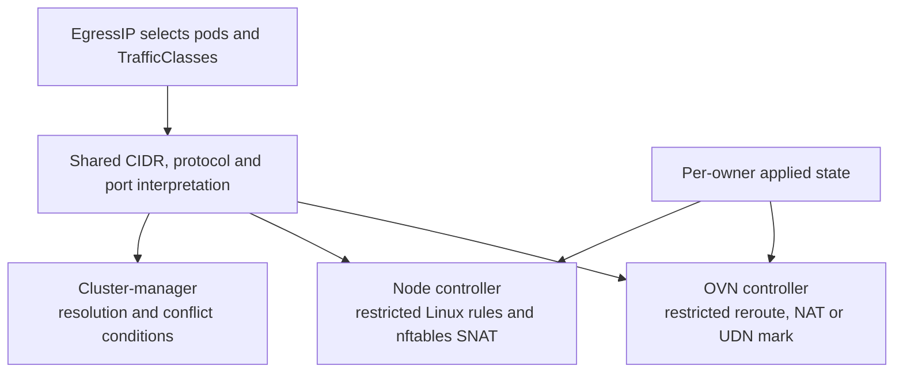

# Egress Traffic Class change map

**Goal:** let one pod use different EgressIPs for different destinations or ports, with an optional catch-all for other traffic. For example: UDP/5060 uses one address, TCP/443 uses another.

Allocation, node assignment, health checks and topology-specific forwarding stay in the existing EgressIP controllers. The substantial changes are **packet matching, per-owner state and shared-resource cleanup**.

This covers `f0fac1f192` plus the working-tree route fix. The six regions below are also the suggested review order.



The controllers reconcile independently from informer state. This shows responsibilities, not a sequence of calls.

## 1 API and shared matching

**What:** select packets separately from selecting pods.

**Before → after:** EgressIP selected workloads and applied to their eligible egress traffic without destination/port selection. Now an optional selector narrows that traffic through reusable TrafficClasses; omitting it retains catch-all behavior.

**How:** add cluster-scoped `EgressTrafficClass` resources containing CIDRs and optional TCP/UDP/SCTP port restrictions. Add `EgressIP.spec.trafficSelector` to select classes by label. Existing namespace/pod selectors still select workloads.

The shared parser validates, expands, deduplicates and sorts matches into comparable `Destination` values. OVN, host programming and conflict detection consume these; each backend renders its own rules.

**Why:** one definition of matching prevents the datapaths and status reporting from interpreting the same class differently.

| Input | Meaning |
|---|---|
| No traffic selector | Catch-all |
| Selector matches no classes | No traffic uses this owner |
| Empty or malformed selector | Rejected where admission validates it; invalid stored selectors match nothing |
| Multiple classes, destinations or protocol entries | OR |
| Source and destination port restrictions within one entry | AND |
| Omitted protocol or port restriction | Wildcard for that dimension |

**Read:** [TrafficClass types](go-controller/pkg/crd/egresstrafficclass/v1/types.go), [EgressIP types](go-controller/pkg/crd/egressip/v1/types.go), [destination.go](go-controller/pkg/util/egressip/destination.go): `HasTrafficSelector`, `ParseTrafficSelector`, `ParseDestinations`, `Destination.Overlaps`.

## 2 OVN assignment ownership

**What:** several selective EgressIPs can serve one pod. Updating or deleting one must preserve the others.

**Before → after:** the OVN pod cache held one active `egressIPName`, its statuses/IPs/network, and standby names for other matching EgressIPs. Now it holds a separate assignment for each active owner, allowing multiple selective owners alongside one catch-all. Multiple catch-alls retain the previous active/standby behavior.

**How:** replace the single active owner in the pod cache with:

```text
podAssignment[pod]
  activeEgressIPs[owner] = {statuses, applied pod IPs, applied network}
  standbyEgressIPNames
```

Each owner uses the common add/delete path. Shared served-pod address-set entries remain while another owner needs them. Additional catch-all owners still use standby behavior.

**Why:** a pooled status map cannot identify which owner installed which configuration. Keeping applied IPs/network also allows cleanup after the API has changed.

**Read:** [ovn/egressip.go](go-controller/pkg/ovn/egressip.go): `podAssignmentState`, `addPodEgressIPAssignments`, `deleteEgressIPAssignments`, `finishPodAssignmentRemoval`.

## 3 OVN matching and live updates

**What:** only matching traffic takes the selective EgressIP; unmatched traffic reaches the catch-all or normal egress path.

**Before → after:** EgressIP reroute policies matched the pod source, default-network SNAT had no traffic-class restriction, and UDN marking used the source plus its existing mark guard. Now selective owners add destination/L4 restrictions to those same constructs. Class edits become a new trigger for rebuilding them; next-hop selection and SNAT placement remain unchanged.

**How:** `resolveEgressTraffic` puts CIDR-only matches in per-owner IPv4/IPv6 address sets and renders L4 matches inline. `buildEgressTrafficMatch` ORs them together. Existing builders reuse that expression:

| Existing datapath | Change |
|---|---|
| Reroute policy | Pod source **AND** destination/L4 expression |
| Default-network OVN SNAT | Same destination/L4 expression |
| Primary UDN | Restrict reroute/packet marking; retain external-bridge OVS SNAT |

Class changes reconcile owners matching old or new labels. The handler locks the owner, fetches the latest EgressIP, resolves classes, removes old assignments and rebuilds current ones. Selector changes reuse this rebuild path.

**Why:** restricting routing alone leaves broad SNAT capable of choosing the wrong source address. Updating only an address set cannot change inline port expressions. Fetching the owner after locking prevents stale class work from replaying an older EgressIP.

UDN marking stays topology-specific: L3 and L2 with a transit router use separate gateway marking policies; L2 without a transit router marks in its reroute policy.

**Read:** [egress_traffic_class.go](go-controller/pkg/ovn/egress_traffic_class.go): `resolveEgressTraffic`, `reconcileEgressTrafficClass`, `rebuildEgressIPAssignments`; [ovn/egressip.go](go-controller/pkg/ovn/egressip.go): `createReroutePolicyOps`, `buildSNATFromEgressIPStatus`, `createGWMarkPolicyOps`.

## 4 Secondary-host rules and shared resources

**What:** support selective EgressIPs on host interfaces, including owners sharing a pod and interface.

**Before → after:** host rules selected traffic by pod source, interface routing tables included default routes, and SNAT maps keyed on pod source/interface. Now selective owners get destination/L4 rules, destination routes in place of their default routes, and explicit selective SNAT rules. Catch-all owners keep the existing maps and default-route behavior; cleanup now tracks shared rule/route references across owners.

**How:** extend the existing node EgressIP controller in three places:

| Region | Change | Why |
|---|---|---|
| Linux policy rules | Match source, destination, protocol and ports; include L4 fields in rule identity/netlink conversion | Distinguish traffic during steering, deletion and repair |
| Routes | Generate destination routes from covering original routes; retain forwarding attributes and non-default routes | Preserve the interface's forwarding configuration |
| nftables | Selective SNAT chain before catch-all maps; match source, interface, destination and L4; rebuild the union atomically | A source/interface SNAT map cannot distinguish selective owners |

`configurationMutex` serializes configuration and peer-reference checks. Shared rules/routes are deleted only when no peer needs them. Routing tables remain shared per interface.

**Route-failure fix:** check ownership using actual route identity, independently of the cached address's interface. Record each successful route addition/release immediately. Otherwise, a failed interface move can leave a new address beside old routes, causing retry to delete a peer's routes or forget partially installed routes.

**Read:** [node egressip.go](go-controller/pkg/node/controllers/egressip/egressip.go): `processEIP`, `generatePodConfig`, `updateEIP`; [traffic.go](go-controller/pkg/node/controllers/egressip/traffic.go): route ownership and selective SNAT; [ip_rule_manager.go](go-controller/pkg/node/iprulemanager/ip_rule_manager.go): `IPRule` conversions.

## 5 Conditions and status writes

**What:** report unresolved selectors and conflicting selective owners without introducing a winner-selection policy.

**Before → after:** EgressIP status contained assignment items, and assignment patches replaced the whole status. Now status also carries traffic-resolution/conflict conditions. Assignment and condition writers patch their own fields so neither erases the other's results; allocation and placement decisions stay unchanged.

**How:** one cluster-manager reconciler computes `TrafficSelectorResolved` and `TrafficConflict`. Conflict requires a common selected pod and intersecting CIDR/protocol/source-port/destination-port matches. Catch-all owners are excluded. Relevant class, owner and workload events trigger recomputation.

Assignment writes patch only `status.items`. Condition writes preserve assignments/unrelated conditions, guard against concurrent changes and skip unchanged writes.

**Why:** conflicts are cluster-wide; node-local writers would have incomplete views. Replacing all of `status` would let assignment updates erase conditions. Overlaps are reported, not rejected or assigned precedence.

**Read:** [egress_traffic_conditions.go](go-controller/pkg/clustermanager/egress_traffic_conditions.go): `reconcileTrafficConditions`, `selectEgressTraffic`, `patchTrafficConditions`; [cluster-manager egressip_controller.go](go-controller/pkg/clustermanager/egressip_controller.go): assignment patches.

## 6 Priority migration and startup repair

**What:** selective matches must beat catch-all matches, including after restart or upgrade.

**Before → after:** all EgressIP reroutes used 100, gateway marks used 95, and host rules used 6000. Startup repaired ordinary EgressIP state. Now catch-all reroutes/host rules move to 99/6001, selective rules get precedence, and startup also repairs class-dependent matches, destination sets and multiple active owners. These priority changes apply even with the new gate disabled.

**How:** separate priorities and repair persisted state from current API objects:

| Mechanism | Selective | Catch-all |
|---|---|---|
| OVN reroute | 100 | 99 |
| UDN gateway marking | 96 | 95 |
| OVN SNAT | 100 | 0 |
| Linux policy rule | 6000 | 6001 |

OVN uses higher priorities first; Linux rules use lower priorities first. OVN startup refreshes matches, migrates policies, removes stale state, reconstructs owner caches and prunes destination sets **after** removing their references. Node startup repairs rules, routes, addresses and SNAT.

**Why:** live event handling cannot repair changes made while controllers were down. Old catch-all priorities would also compete with selective policies.

**Read:** [egress_traffic_class.go](go-controller/pkg/ovn/egress_traffic_class.go): `migrateEgressIPReroutePriorities`, `pruneEgressTraffic`; [ovn/egressip.go](go-controller/pkg/ovn/egressip.go): `syncEgressIPs`; [node egressip.go](go-controller/pkg/node/controllers/egressip/egressip.go): `repairNode`.

## Wiring and boundaries

- **Wiring:** generated clients, [watch factories](go-controller/pkg/factory/factory.go), event handlers, RBAC and Helm/Kind configuration connect the new resource to existing controllers.
- **Gate:** `--enable-egress-traffic-class` defaults off and implies EgressIP. Off ignores selectors; it does **not** restore old priority numbers.
- **Scope:** secondary-host UDN EgressIPs remain unsupported. Selective secondary-host plus OVN catch-all is supported; the reverse combination is not.
- **Compatibility:** upgrade all components before creating selective owners; older binaries treat them as catch-all. Follow the [rollback procedure](docs/features/cluster-egress-controls/egress-traffic-class.md#upgrade-and-rollback).
- **Failure model:** individual OVN/nftables transactions are atomic; the full cross-component update is not. Applied-state tracking and retries must bridge failures.

Read the [OVN reconciliation tests](go-controller/pkg/ovn/egress_traffic_class_test.go) and [node lifecycle tests](go-controller/pkg/node/controllers/egressip/traffic_test.go) alongside regions 2–4. The new route-failure regressions remain unexecuted; historical validation is in the [plan](egress-traffic-class-pr-plan.md).
